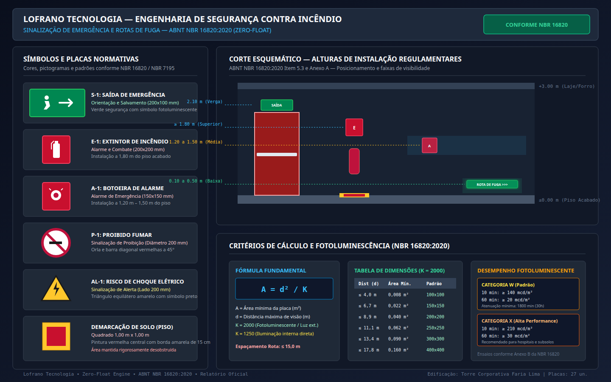
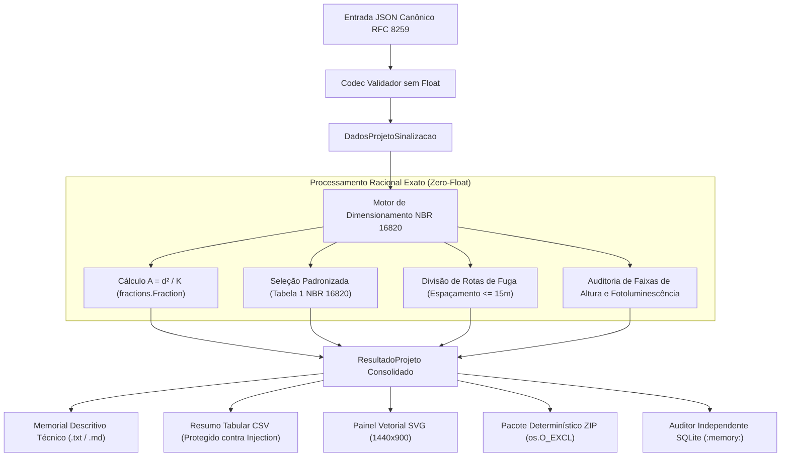

# dimensionamento-sinalizacao-emergencia-nbr16820

[](https://github.com/martinlofranodeoliveira/dimensionamento-sinalizacao-emergencia-nbr16820/actions/workflows/ci.yml)
[](https://www.python.org/)
[](https://opensource.org/licenses/MIT)
[](https://www.abnt.org.br/)
[](https://github.com/martinlofranodeoliveira)

Motor determinístico de engenharia para projeto, cálculo e auditoria de **Sistemas de Sinalização de Emergência e Pânico Contra Incêndio** em estrita conformidade com a norma técnica **ABNT NBR 16820:2020** (que cancelou e substituiu a antiga ABNT NBR 13434 partes 1, 2 e 3).

Desenvolvido segundo as diretrizes de integridade e excelência da **Lofrano Tecnologia**, o motor adota **Zero-Float inegociável** (aritmética estritamente racional via `fractions.Fraction` e inteiros), proteção contra injeção de fórmulas CSV, codecs JSON canônicos conforme RFC 8259, gerador de painéis técnicos vetoriais SVG (1440x900) e auditor independente em SQLite desacoplado.

---



---

## 1. Fundamentação Normativa e Engenharia (ABNT NBR 16820:2020)

A norma ABNT NBR 16820:2020 regulamenta as características físicas, geométricas, visuais e de fotoluminescência dos sistemas de sinalização de emergência em edificações industriais, comerciais e institucionais.

### 1.1 Fórmula Fundamental de Dimensionamento de Placas

A área mínima visualizável de qualquer placa de sinalização é calculada pelo item 5.1.2 da NBR 16820 através da relação matemática:

$$A = \frac{d^2}{K}$$

Onde:
- **$A$**: Área mínima da placa em metros quadrados ($\text{m}^2$).
- **$d$**: Distância máxima de visualização em metros ($\text{m}$), medida em linha reta do observador ao ponto de fixação.
- **$K$**: Fator de visibilidade adimensional:
  - **$K = 2000$**: Para placas fotoluminescentes ou sinalização iluminada externamente por fonte de luz ambiente.
  - **$K = 1250$**: Para sinalização com iluminação interna direta contínua (luminárias autônomas ou centrais translúcidas).

### 1.2 Regras de Espaçamento e Distribuição em Rotas de Fuga

- **Espaçamento Máximo em Linha Reta**: A distância máxima entre duas placas consecutivas em corredores e rotas de fuga não pode exceder **$15{,}0\text{ m}$** (Item 5.2.1).
- **Mudanças de Direção**: Obrigatória a instalação de placas indicativas de orientação com setas direcionais em todas as curvas, cruzamentos ou bifurcações.
- **Portas de Saída**: Cada porta integrante de rota de fuga deve possuir sinalização sobre a verga ou no eixo superior.

### 1.3 Faixas Regulamentares de Altura de Instalação (Item 5.3 e Anexo A)

| Faixa de Altura | Altura do Piso Acabado | Tipos de Sinalização Aplicáveis |
|---|---|---|
| **Superior** | $h \ge 1{,}80\text{ m}$ (nominal $2{,}10\text{ m}$) | Saídas sobre portas, extintores, hidrantes e placas visíveis à distância |
| **Média** | $1{,}20\text{ m} \le h \le 1{,}50\text{ m}$ (nominal $1{,}35\text{ m}$) | Acionadores manuais de alarme de incêndio, interfones e botoeiras |
| **Baixa / Rodapé** | $0{,}10\text{ m} \le h \le 0{,}50\text{ m}$ (nominal $0{,}25\text{ m}$) | Sinalização fotoluminescente de escape contra fumaça estratificada |
| **Solo / Piso** | $\pm 0{,}00\text{ m}$ (Diretamente no piso) | Demarcação de área de extintores e hidrantes ($1{,}00\text{ m} \times 1{,}00\text{ m}$) |

### 1.4 Desempenho Fotoluminescente Mínimo (Item 6.1 e Tabela B.1)

| Categoria | Luminância a 10 min | Luminância a 60 min | Tempo Mínimo de Atenuação (até $0{,}3\text{ mcd/m}^2$) |
|---|---|---|---|
| **Categoria W** | $\ge 140\text{ mcd/m}^2$ | $\ge 20\text{ mcd/m}^2$ | $\ge 1800\text{ minutos}$ ($30\text{ horas}$) |
| **Categoria X** | $\ge 210\text{ mcd/m}^2$ | $\ge 30\text{ mcd/m}^2$ | $\ge 1800\text{ minutos}$ ($30\text{ horas}$) |

---

## 2. Arquitetura do Sistema e Fluxo de Execução



---

## 3. Instalação e Requisitos

O pacote utiliza exclusivamente a biblioteca padrão do Python (**Zero Dependências Externas**).

```bash
# Clone o repositório
git clone https://github.com/martinlofranodeoliveira/dimensionamento-sinalizacao-emergencia-nbr16820.git
cd dimensionamento-sinalizacao-emergencia-nbr16820

# Instalação em modo de desenvolvimento ou limpo
pip install .
```

Requisitos:
- Python 3.11 ou superior (totalmente compatível com Python 3.11, 3.12, 3.13 e 3.14).

---

## 4. Uso via Linha de Comando (CLI)

O executável de linha de comando `sinalizacao-nbr16820` oferece controle completo sobre dimensionamentos, catálogos e geração de artefatos.

### 4.1 Dimensionar e Gerar Memorial Técnico Completo

```bash
sinalizacao-nbr16820 calcular examples/edificio_comercial_rotas_fuga.json
```

### 4.2 Gerar Pacote Determinístico ZIP e Painel SVG

```bash
sinalizacao-nbr16820 calcular examples/edificio_comercial_rotas_fuga.json \
  --formato svg \
  --saida painel.svg \
  --pacote-zip dist/pacote_sinalizacao.zip
```

### 4.3 Consultar Catálogo de Parâmetros e Dimensões

```bash
sinalizacao-nbr16820 catalogo
```

### 4.4 Gerar Modelo JSON para Preenchimento

```bash
sinalizacao-nbr16820 gerar-exemplo -o meu_projeto_sinalizacao.json
```

---

## 5. Uso como Biblioteca Python

```python
from fractions import Fraction
from sinalizacao_nbr16820 import (
    DadosPlaca,
    DadosProjetoSinalizacao,
    DadosTrechoRota,
    FormaGeometrica,
    PosicaoInstalacao,
    TipoSinalizacao,
    CategoriaFotoluminescente,
    dimensionar_projeto,
    gerar_memorial_descritivo,
)

# 1. Definição das placas e equipamentos
placa_extintor = DadosPlaca(
    id="EXT-01",
    codigo="E-1",
    descricao="Extintor ABC 6kg - Hall Principal",
    tipo=TipoSinalizacao.COMBATE_INCENDIO,
    distancia_visualizacao_m=Fraction(8, 1),
    forma=FormaGeometrica.QUADRADA,
    posicao=PosicaoInstalacao.SUPERIOR,
    altura_instalacao_m=Fraction(18, 10),
    categoria_fotoluminescente=CategoriaFotoluminescente.CATEGORIA_W,
    quantidade=2,
)

# 2. Definição do trecho da rota de fuga
trecho_fuga = DadosTrechoRota(
    id="ROTA-01",
    descricao="Corredor Principal de Saída de Emergência",
    comprimento_m=Fraction(35, 1),
    mudancas_direcao=1,
    portas_saida=2,
)

# 3. Consolidação e processamento do projeto
projeto = DadosProjetoSinalizacao(
    identificacao_edificio="Edifício Comercial Paulista",
    ocupacao="Serviços Administrativos",
    responsavel_tecnico="Eng. Martin Lofrano de Oliveira - CREA/SP",
    placas_individuais=[placa_extintor],
    trechos_rotas=[trecho_fuga],
)

resultado = dimensionar_projeto(projeto)

print(f"Status NBR 16820: {'CONFORME' if resultado.conformidade_geral else 'INCONFORME'}")
print(f"Total de Placas Geradas: {resultado.total_placas_unidades} unidades")

# 4. Emissão do memorial técnico
memorial = gerar_memorial_descritivo(resultado)
print(memorial)
```

---

## 6. Auditoria Independente Desacoplada (SQLite)

O projeto inclui ferramenta de auditoria independente (`tools/verify_independent.py`) que **não importa nenhum módulo da aplicação** e utiliza banco de dados em memória (`:memory:`) para validar as relações físicas e normativas:

```bash
python3 tools/verify_independent.py
```

Resultados auditados automaticamente:
- Cálculo exato de $A = d^2 / K$ sem desvio de ponto flutuante.
- Verificação de espaçamento máximo de $15{,}0\text{ m}$ em todos os trechos de fuga.
- Verificação de alturas regulamentares por posição de fixação.
- Validação de categorias fotoluminescentes W e X.

---

## 7. Garantias de Qualidade e Segurança

- **Zero-Float Engine**: Inexistência de ponto flutuante IEEE-754 em cálculos geométricos e dimensionais.
- **Proteção contra Injeção em Planilhas**: O exportador CSV sanitiza qualquer campo iniciado por `=`, `+`, `-`, `@`, `\t` ou `\r`.
- **Determinismo ZIP com `os.O_EXCL`**: Prevenção ativa de sobrescrita acidental e carimbo de data fixado em `2026-01-01 00:00:00`.
- **Multiplataforma CI**: Testes contínuos em Ubuntu (Python 3.11, 3.12, 3.13 e 3.14) e Windows (Python 3.14).
- **Isolamento de Rede**: Verificação com `unshare -r -n` para garantir execução 100% offline.

---

## 8. Licença

Distribuído sob a licença **MIT**. Consulte o arquivo [LICENSE](LICENSE) para mais detalhes.

---
**Lofrano Tecnologia** • Engenharia de Segurança Contra Incêndio • São Paulo, Brasil • 2026
